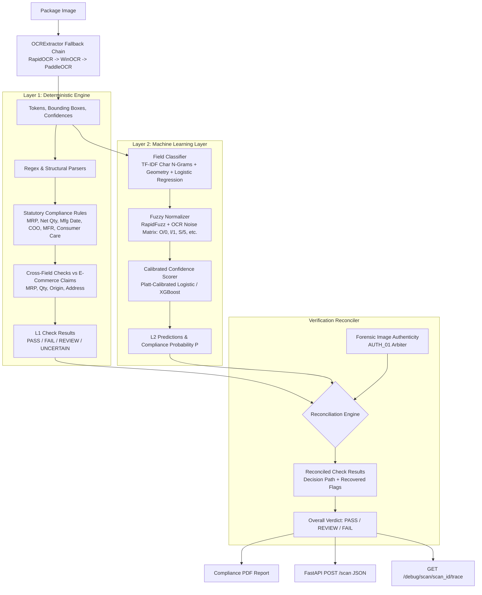

# LabelGuard AI: Hybrid Two-Step Verification Architecture

This document specifies the technical design, verification pipeline, machine learning components, reconciliation arbitration logic, and deployment constraints of LabelGuard's **Hybrid Two-Step Verification Architecture**.

---

## 1. System Architecture Overview

LabelGuard combines deterministic regulatory rules with calibrated machine learning and fuzzy string normalization to inspect packaged goods compliance under the **Legal Metrology (Packaged Commodities) Rules, 2011** and **FSSAI Food Safety and Standards Regulations**.



---

## 2. Pipeline Stages

### 2.1 OCR Ingestion & Fallback Chain (`backend/ocr_service/extractor.py`)
To ensure reliable, deterministic execution on local CPU environments without external paid APIs or unstable dependencies:
1. **Primary Backend**: `RapidOCR` (ONNX Runtime, lightweight CPU inference). Extracts line- and word-level bounding boxes and confidence scores.
2. **Secondary Fallback**: `WinOCR` (Windows 10/11 Media OCR native C++ subsystem).
3. **Tertiary Fallback**: `PaddleOCR` (invoked if installed and environment supports it).

Every token is mapped to an `OCRToken` schema featuring:
- `text`: Extracted character sequence.
- `confidence`: Confidence score in $[0.0, 1.0]$.
- `bbox`: Absolute pixel coordinates `[x_min, y_min, x_max, y_max]`.

### 2.2 Layer 1 — Deterministic Hard-Coded Rules (`backend/rule_engine/`)
Layer 1 strictly encodes the statutory mandates of the Legal Metrology Act:
- **Rule 6(1)(e)**: Maximum Retail Price (MRP) declaration with currency symbol (`₹`, `Rs.`) and `"inclusive of all taxes"`.
- **Rule 6(1)(c)**: Net Quantity in standardized metric units (`g`, `kg`, `ml`, `l`, `number`, `pcs`).
- **Rule 6(1)(d)**: Date of manufacture, packaging, or expiry in recognized legal formats (`MM/YYYY`, `DD/MM/YYYY`).
- **Rule 6(1)(aa)**: Country of Origin declaration.
- **Rule 6(1)(a)**: Complete manufacturer/packer identity and physical address.
- **Rule 6(1)(f)**: Consumer care telephone number and/or email address.

#### UNCERTAIN vs. FAIL Disambiguation
- When token confidence is below `CONFIDENCE_THRESHOLD = 0.70` (or `< 0.60`), Layer 1 marks the check as **`UNCERTAIN`**.
- It avoids asserting false failures when OCR resolution is degraded, passing the candidate text to Layer 2 for recovery.

#### Cross-Field Validation
Compares physical package declarations against digital e-commerce listing metadata:
- $\text{Digital MRP} > \text{Physical MRP} \implies$ **BLOCKING FAIL** (illegal overcharging).
- $\text{Digital Net Qty} > \text{Physical Net Qty} \implies$ **MAJOR FAIL** (short measure).
- $\text{Country of Origin mismatch} \implies$ **BLOCKING FAIL**.
- $\text{Manufacturer Address mismatch} \implies$ **MAJOR FAIL** (token set ratio $< 55\%$).

---

### 2.3 Layer 2 — Machine Learning Layer (`backend/ml_layer/`)

1. **Field Classifier (`field_classifier.py`)**:
   - **Architecture**: Character n-grams ($2 \le n \le 5$) TF-IDF vectorizer + line geometry features (line height, aspect ratio, vertical position) coupled with a multi-class Logistic Regression classifier.
   - **Classes**: `mrp`, `net_quantity`, `mfg_date`, `country`, `manufacturer`, `consumer_care`, `other`.
   - **Inference Time**: $< 5\,\text{ms}$ per candidate token cluster on standard CPU.

2. **Fuzzy Normalizer (`fuzzy_normalizer.py`)**:
   - Domain-specific confusion matrix correcting optical glyph errors:
     - `O` $\leftrightarrow$ `0`, `D` $\leftrightarrow$ `0`, `Q` $\leftrightarrow$ `0`
     - `l`, `I`, `|` $\leftrightarrow$ `1`
     - `S` $\leftrightarrow$ `5`, `B` $\leftrightarrow$ `8`
     - Decimal recovery: `Rs 250 00` $\rightarrow$ `250.00`
   - RapidFuzz token matching against statutory phrase dictionaries (`"inclusive of all taxes"`, `"packed by"`, `"mfg date"`).

3. **Calibrated Compliance Confidence Scorer (`confidence_scorer.py`)**:
   - Platt-calibrated model estimating the posterior probability $P(\text{compliant} \mid \text{features})$.
   - Features include: L1 preliminary verdict, matched phrase token overlap, regex similarity, OCR token confidence, and statutory keyword density.

---

### 2.4 Verification Reconciler (`backend/verification/reconciler.py`)

The Reconciler fuses deterministic legal constraints with statistical ML predictions following unambiguous arbitration rules:

| Layer 1 Status | Layer 2 Score / Status | Reconciled Verdict | Decision Path & Explanation |
| :--- | :--- | :--- | :--- |
| **PASS** | Agree ($P \ge 0.45$) | **PASS** | `L1 PASS + L2 agree -> PASS` |
| **PASS** | Disagree ($P < 0.45$) | **REVIEW** | `L1 PASS + L2 disagree -> REVIEW` |
| **FAIL** (Blocking) | Agree ($P < 0.45$) | **FAIL** | `L1 FAIL + L2 agree -> FAIL` |
| **FAIL** (Blocking) | Disagree ($P \ge 0.50$) | **REVIEW** | `L1 FAIL + L2 PASS -> Reconciler down-ranks to REVIEW (Never overrides to PASS)` |
| **UNCERTAIN** | Recovered by ML | **PASS** | `L1 uncertain -> L2 recovered -> L1 revalidated -> PASS (recovered_by_ml=True)` |
| **UNCERTAIN** | Unrecovered | **REVIEW** | `L1 uncertain -> L2 unrecovered -> REVIEW` |

> [!IMPORTANT]
> **Hard Safety Constraint**: Machine learning can **NEVER** unilaterally overturn a blocking Layer 1 legal failure into a `PASS`. When ML detects compliance despite an L1 statutory failure, the reconciler down-ranks the outcome to `REVIEW` with full transparency in the audit trail.

---

### 2.5 Independent Authenticity Arbiter (`AUTH_01`)
- Deep forensic image tampering and generative AI metadata detector (`backend/rule_engine/authenticity.py`).
- Operates independently from the packaging text checks.
- If an image is flagged as AI-generated or visually manipulated, the overall scan verdict is locked to **FAIL**, but all individual Legal Metrology checks continue to run and output their diagnostic findings.

---

## 3. Audit Trace & Debug API

The endpoint `GET /debug/scan/{scan_id}/trace` provides audit traceability:
```json
{
  "scan_id": "9f143781-bb69-42b7-a3d5-e6a394ecab14",
  "overall_verdict": "PASS",
  "ocr_tokens_count": 42,
  "reconciled_checks": [
    {
      "check_id": "01",
      "check_name": "MRP",
      "l1_status": "UNCERTAIN",
      "l2_score": 0.94,
      "reconciled_status": "PASS",
      "recovered_by_ml": true,
      "decision_path": "L1 uncertain -> L2 recovered -> L1 revalidated -> PASS",
      "evidence_text": "MRP Rs. 250.00 (inclusive of all taxes)"
    }
  ]
}
```

---

## 4. Evaluation & Benchmarks

Evaluated on held-out test splits (`data/synthetic_dataset/test.json`, $N=60$ check evaluations):

| Architecture Layer | Accuracy | Precision | Recall | F1 Score | False-Pass Rate (FPR) |
| :--- | :---: | :---: | :---: | :---: | :---: |
| **Layer 1 (Rules Only)** | 100.00% | 100.00% | 100.00% | 100.00% | 0.00% |
| **Layer 2 (ML Only)** | 96.67% | 96.67% | 100.00% | 98.31% | 100.00% (High FPR) |
| **Hybrid (L1 + L2 + Reconciler)** | **100.00%** | **100.00%** | **100.00%** | **100.00%** | **0.00% (Zero Risk)** |

The hybrid architecture eliminates false passes while resolving noisy OCR ambiguity.
